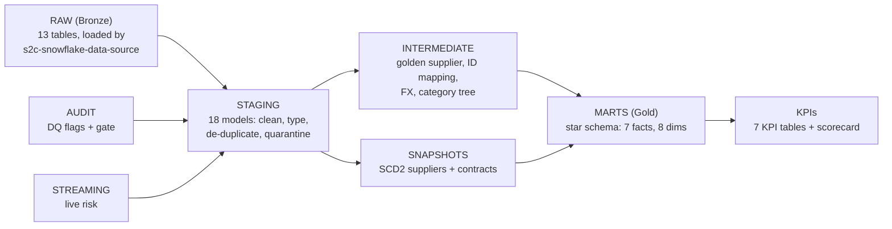
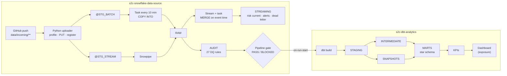

# s2c-dbt-analytics

**dbt Core project for Source-to-Contract (S2C) procurement analytics on Snowflake.**

This repo turns the raw data loaded by **[s2c-snowflake-data-source](https://github.com/diponkarsinha/s2c-snowflake-data-source)** into clean, tested, documented tables and KPIs for a fictional *Sample pharmaceutical company*. It also holds the full learning material for the project: question banks, interview stories and a day-by-day guide.

| Repo | Role |
|---|---|
| [s2c-snowflake-data-source](https://github.com/diponkarsinha/s2c-snowflake-data-source) | Sources, GitHub landing zone, Python uploader, Snowflake RAW + audit layer + streaming |
| **s2c-dbt-analytics** (this repo) | dbt: staging → intermediate → star schema → KPIs, tests, docs, CI, learning material |

> All data is synthetic. No real company, supplier or person is represented.



## What's inside

| Layer | Models | Highlights |
|---|---|---|
| Sources | 13 RAW + audit + streaming | Freshness, file lineage, gate check before every run |
| Staging | `stg_sap__*`, `stg_ariba__*`, `stg_risk__*`, `stg_ref__*`, `stg_manual__savings`, `quarantine_sap__po_items` | Decimal comma, YYYYMMDD dates, XMLGET, multi-level FLATTEN, dedup with QUALIFY, ERROR rows quarantined, schema-drift column, email masking |
| Intermediate | `int_supplier_golden_record`, `int_supplier_mapping`, `int_fx_monthly`, `int_category_hierarchy` (recursive CTE), `int_po_items_enriched`, `int_invoice_lines_enriched` | Duplicate suppliers merged by VAT, Ariba → SAP matching, EUR conversion, compliance flags |
| Snapshots | `snap_sap_suppliers` (check), `snap_contract_status` (timestamp) | SCD Type 2 history |
| Marts | `fct_spend`, `fct_invoice_line` (incremental), `fct_purchase_order_line` (incremental), `fct_sourcing_event`, `fct_bid`, `fct_savings`, `fct_request_pipeline`, `dim_*` | Kimball star schema, model contract on `dim_category` |
| KPIs | `kpi_spend_monthly`, `kpi_supplier_risk_exposure`, `kpi_sourcing_performance`, `kpi_savings_validation`, `kpi_contract_renewals`, `kpi_invoice_price_variance`, `kpi_scorecard` | 11 KPIs vs targets (seed) |
| Tests | 116 generic, 12 singular, 1 unit test | Business rules are **warn** (reported, not hidden); reconciliations are **error** |

## End-to-end flow



## Test results (all 12 delivery waves, end to end)

| Check | Result |
|---|---|
| Planted issues (answer key, 214) | **caught 37** by the audit layer, **177** by dbt tests, **0 missed** |
| Final `dbt build` | **PASS 168 · WARN 15 · ERROR 0** (the 15 warnings are the planted business issues) |
| PO lines in the fact | 3,244 initial → 3,297 (wave 1) → 3,319 (after wave 6 quarantine) |
| Supplier golden record | 200 suppliers; 8 → 9 with duplicate SAP IDs (wave 8) |
| Contract history (SCD2) | 20 rows for the 10 contracts changed in wave 10 |
| Stream | spike alert raised; out-of-order event did not overwrite the newer score; late and invalid events handled |

## Quick start

```bash
# 1. Python + dbt
python3 -m venv .venv && source .venv/bin/activate
pip install --only-binary=:all: -r requirements.txt

# 2. Snowflake: run snowflake/dbt_user_setup.sql as ACCOUNTADMIN (creates S2C_DBT_SVC)

# 3. Your login
mkdir -p ~/.dbt && cp profiles.yml.example ~/.dbt/profiles.yml   # edit if needed
dbt debug

# 4. Build everything (seeds, models, snapshots and tests, in dependency order)
dbt build
dbt docs generate && dbt docs serve
```

Step-by-step guide with expected results: **[docs/setup.md](docs/setup.md)**

## Key design choices

- **Gate before Gold:** the `on-run-start` hook reads `AUDIT.V_PIPELINE_GATE`; if files are missing or incomplete, nothing is rebuilt.
- **Quarantine, don't delete:** rows the audit layer marked ERROR skip staging but stay visible in `quarantine_sap__po_items`.
- **Warn on business problems:** blocked suppliers, closed cost centres, overlapping contracts, wrong savings maths and orphan invoices are *data*, so tests report them with severity `warn` instead of breaking the build.
- **Error on broken pipelines:** reconciliation (staging total = fact total) and reversal checks are `error`.
- **Incremental on load time:** late-arriving invoices (posted in September, delivered in November) are picked up because the filter uses `loaded_at`, with a lookback window.
- **Golden supplier:** facts join on one supplier ID per VAT number, so duplicated SAP vendors don't split spend.

## Docs

| Doc | Content |
|---|---|
| [docs/setup.md](docs/setup.md) | Install, connect, build, check |
| [docs/dimensional_model.md](docs/dimensional_model.md) | Star schema diagram + grain of every table |
| [docs/kpi_catalog.md](docs/kpi_catalog.md) | 11 KPIs: question, formula, grain, model, refresh, target |
| `dbt docs serve` | Full lineage graph and column descriptions |

## Roadmap
- Phase 2: Azure landing zone (ADLS external stage, Snowpipe auto-ingest with Event Grid)
- Phase 3: Airflow DAG (Cosmos) orchestrating upload → load → DQ → dbt build
