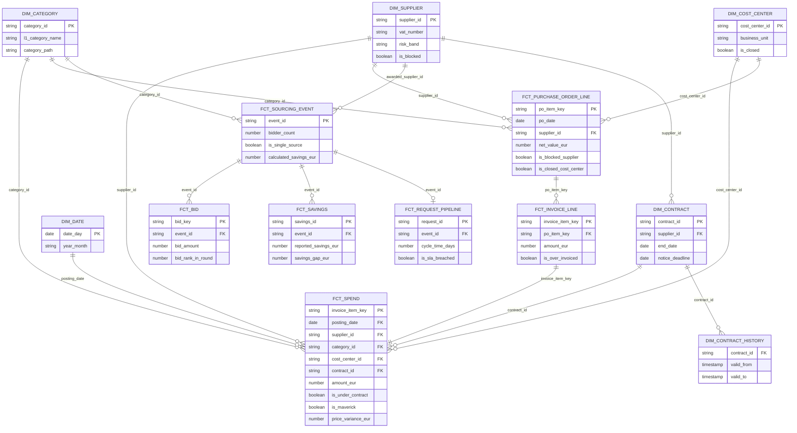

# Dimensional model (Gold layer)

Kimball star schema in `S2C_DEV.MARTS`. Facts hold events and amounts; dimensions describe them.

## Grain of every table

| Table | Grain | Type |
|---|---|---|
| `fct_spend` | One invoice line | Fact (main spend fact) |
| `fct_invoice_line` | One invoice line | Fact, incremental |
| `fct_purchase_order_line` | One PO line | Fact, incremental |
| `fct_sourcing_event` | One sourcing event | Fact (accumulating) |
| `fct_bid` | One bid per round | Fact |
| `fct_savings` | One savings line | Fact |
| `fct_request_pipeline` | One request | Fact (accumulating snapshot of the S2C chain) |
| `dim_supplier` | One real supplier (golden record by VAT) | Dimension, type 1 (current) |
| `dim_supplier_history` | One version of an SAP supplier | Dimension, type 2 (from snapshot) |
| `dim_contract` | One contract (current) | Dimension |
| `dim_contract_history` | One version of a contract | Dimension, type 2 (from snapshot) |
| `dim_category` | One category | Dimension (model contract enforced) |
| `dim_cost_center` | One cost centre | Dimension |
| `dim_employee` | One approver | Dimension (recursive org chart) |
| `dim_date` | One day | Dimension |

## Why spend = invoices, not POs
A PO is a promise to buy; an invoice is money actually owed. Finance reports invoices, so `fct_spend` is built on invoice lines. PO-level facts are kept for compliance checks (blocked suppliers, closed cost centres) that happen *before* money is spent.

## Why one golden supplier
SAP has the same company under several IDs (duplicates), and Ariba uses its own IDs. Joining facts on raw SAP IDs would split one supplier's spend into several rows. All facts carry the **golden** `supplier_id` (oldest SAP ID for the VAT number).
